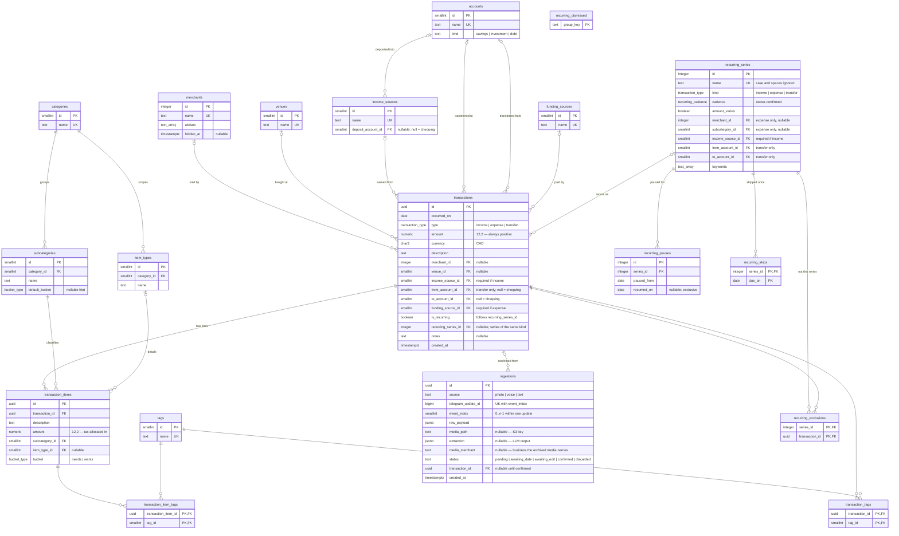

# Data model

The schema contract. `supabase/migrations/` must agree with this file; change
both in the same commit. For *why* the storage layer looks like this, see
[ARCHITECTURE.md](ARCHITECTURE.md); for the classification taxonomy the seed
data implements, see [TAXONOMY.md](TAXONOMY.md); for when each choice was
made, see [DECISIONS.md](DECISIONS.md).

## Shape in one paragraph

Transactions are `income | expense | transfer` **headers**; classification
lives on `transaction_items` **lines**. A three-level taxonomy — 11 categories
→ 54 subcategories → item types where they earn their keep (see
[TAXONOMY.md](TAXONOMY.md)) — classifies each line, along with a per-line
needs/wants `bucket`. Every expense has at least one line; a receipt with
line-item detail has many, and lines from one receipt may belong to different
categories. Merchants, venues, funding sources, income sources, and accounts
are lookup tables; tags stay for free-form *context* only (Travel, Social,
Avoidable…), on the header when they cover the whole transaction and on a
line when the owner gives them for that line only. Every Telegram message lands in `ingestions` before it can
become a confirmed transaction.

## Entity-relationship diagram

The diagram shows entities, keys, and relationship cardinality only. Check
constraints, enum values, and cross-table rules (tax allocation, the
item-type/subcategory category match) are not representable here — the DDL
below and [Invariants](#invariants) remain the authority.



## DDL

```sql
create type transaction_type as enum ('income', 'expense', 'transfer');
create type bucket_type      as enum ('needs', 'wants');

create table categories (
  id   smallint generated always as identity primary key,
  name text not null unique
);

create table subcategories (
  id             smallint generated always as identity primary key,
  category_id    smallint not null references categories(id),
  name           text not null,
  default_bucket bucket_type,      -- extraction hint only; the authoritative
                                   -- bucket is per line item
  unique (category_id, name)
);

-- Third classification level, only for categories where it earns its keep
-- (see TAXONOMY.md). Scoped to a category, not a subcategory: Food & drink
-- item types apply across all its channels.
create table item_types (
  id          smallint generated always as identity primary key,
  category_id smallint not null references categories(id),
  name        text not null,
  unique (category_id, name)
);

create table merchants (
  id      integer generated always as identity primary key,
  name    text not null unique,
  aliases text[] not null default '{}',           -- for LLM normalization
  hidden_at timestamptz                           -- set: kept on past rows, not offered or linked
);

-- Venue / channel of purchase (Supermarket, Coffee Shop, Pharmacy, ...).
-- Single-valued per transaction, unlike tags.
create table venues (
  id   smallint generated always as identity primary key,
  name text not null unique
);

create table accounts (
  id   smallint generated always as identity primary key,
  name text not null unique,                      -- values seeded locally
  -- debt (migration 0017): a loan an extra payment is transferred into
  kind text not null check (kind in ('savings', 'investment', 'debt'))
);

-- deposit_account_id is where income from this source lands (interest paid
-- into a savings account); null means chequing. Set in the seed overlay, not
-- per transaction: the source already says where its money goes.
create table income_sources (
  id                 smallint generated always as identity primary key,
  name               text not null unique,        -- values seeded locally
  deposit_account_id smallint references accounts(id)
);

-- Who paid for an expense. Null on income and transfer. The tracked seed
-- contains only 'self'; additional sources are personal and live in the
-- untracked overlay.
create table funding_sources (
  id   smallint generated always as identity primary key,
  name text not null unique
);

-- Free-form context only (Travel, Social, Avoidable, ...). Venues and
-- merchants are NOT tags.
create table tags (
  id   smallint generated always as identity primary key,
  name text not null unique
);

create table transactions (
  id                uuid primary key default gen_random_uuid(),
  occurred_on       date not null,
  type              transaction_type not null,
  amount            numeric(12,2) not null check (amount > 0),
  currency          char(3) not null default 'CAD',
  description       text not null,
  merchant_id       integer  references merchants(id),
  venue_id          smallint references venues(id),
  income_source_id  smallint references income_sources(id),
  from_account_id   smallint references accounts(id),  -- null = chequing
  to_account_id     smallint references accounts(id),  -- null = chequing
  funding_source_id smallint references funding_sources(id),
  is_recurring      boolean not null default false,  -- follows the link (trigger below)
  recurring_series_id integer,                       -- migration 0016; FK below
  notes             text,
  created_at        timestamptz not null default now(),
  check (type <> 'income'   or income_source_id is not null),
  -- A transfer names at least one account, and not the same one twice:
  -- to set is a deposit, from set a withdrawal, both a move between accounts.
  constraint transactions_transfer_accounts check (
    type <> 'transfer'
    or (coalesce(from_account_id, to_account_id) is not null
        and from_account_id is distinct from to_account_id)),
  constraint transactions_from_account_transfer_only
    check (type = 'transfer' or from_account_id is null),
  check (type <> 'expense'  or funding_source_id is not null),
  check (type =  'expense'  or funding_source_id is null)
);
create index on transactions (occurred_on);

-- Receipt line items. Classification lives here, not on the header, because
-- one receipt can span categories and one meal can span item types. A simple
-- quick-log expense gets exactly one line mirroring the header.
create table transaction_items (
  id             uuid primary key default gen_random_uuid(),
  transaction_id uuid not null references transactions(id) on delete cascade,
  description    text not null,
  amount         numeric(12,2) not null check (amount > 0),
  subcategory_id smallint not null references subcategories(id),
  item_type_id   smallint references item_types(id),
  bucket         bucket_type not null
);
create index on transaction_items (transaction_id);
create index on transaction_items (subcategory_id);

-- Whole-transaction context ("road trip snacks" -> Travel). The only place
-- income and transfers, which have no lines, carry a tag.
create table transaction_tags (
  transaction_id uuid     not null references transactions(id) on delete cascade,
  tag_id         smallint not null references tags(id),
  primary key (transaction_id, tag_id)
);

-- Context the owner gives for one line only ("the bananas were for
-- Partner"). Migration 0012.
create table transaction_item_tags (
  transaction_item_id uuid     not null references transaction_items(id) on delete cascade,
  tag_id              smallint not null references tags(id),
  primary key (transaction_item_id, tag_id)
);

-- Audit + human-in-the-loop staging. Every Telegram message lands here first.
create table ingestions (
  id                 uuid primary key default gen_random_uuid(),
  source             text not null check (source in ('photo','voice','text')),
  telegram_update_id bigint not null,             -- one update → 1..n rows
  event_index        smallint not null default 0  -- order within the update
                     check (event_index >= 0),
  raw_payload        jsonb not null,              -- full Telegram update
  media_path         text,                        -- S3 object key: {source}/{yyyy-mm}/{id}.{ext}; older rows are flat {id}.{ext}
  extraction         jsonb,                       -- LLM structured output
  media_merchant     text,                        -- business a re-read of the
                                                  -- archived media names (backfill)
  status             text not null default 'pending'
                     check (status in ('pending','awaiting_date','awaiting_edit','confirmed','discarded')),
  transaction_id     uuid references transactions(id),
  created_at         timestamptz not null default now()
  ,unique (telegram_update_id, event_index)       -- idempotent webhook retries
);

-- Recurring series (migration 0016, Phase 4.5). The tables ship empty; the
-- owner's series live only in their database. Anchor day, expected window,
-- typical amount and missed count are derived on read by
-- lambda/src/recurring.ts and never stored. Needs Postgres 15+ (SET NULL
-- with a column list) and btree_gist, installed in schema extensions.
create extension if not exists btree_gist with schema extensions;

create type recurring_cadence as enum
  ('weekly', 'biweekly', 'semimonthly', 'monthly', 'quarterly', 'yearly');

-- Match keys: income source (income), accounts (transfer); an expense matches
-- on merchant, subcategory, or its description against the name, keywords
-- and linked descriptions by token overlap, so the name is enough of a key.
create table recurring_series (
  id               integer generated always as identity primary key,
  name             text not null check (btrim(name) <> '' and length(name) <= 60),
  kind             transaction_type not null,
  cadence          recurring_cadence not null,         -- owner-confirmed, so thin history still has one
  amount_varies    boolean not null default false,     -- true: no typical amount, no band
  merchant_id      integer  references merchants(id),
  subcategory_id   smallint references subcategories(id),
  income_source_id smallint references income_sources(id),
  from_account_id  smallint references accounts(id),   -- null = chequing
  to_account_id    smallint references accounts(id),
  keywords         text[] not null default '{}',       -- extra phrases a description may use
  created_at       timestamptz not null default now(),
  unique (id, kind),
  check (kind <> 'income' or income_source_id is not null),
  check (kind =  'income' or income_source_id is null),
  check (kind <> 'transfer'
         or (coalesce(from_account_id, to_account_id) is not null
             and from_account_id is distinct from to_account_id)),
  check (kind =  'transfer' or (from_account_id is null and to_account_id is null)),
  check (kind =  'expense' or (merchant_id is null and subcategory_id is null))
);
create unique index recurring_series_name_key on recurring_series (lower(btrim(name)));

-- A linked transaction's type equals its series' kind. Deleting a series
-- clears only the link.
alter table transactions add constraint transactions_recurring_series_fkey
  foreign key (recurring_series_id, type) references recurring_series (id, kind)
  on delete set null (recurring_series_id);
create index transactions_recurring_series_idx
  on transactions (recurring_series_id) where recurring_series_id is not null;

-- A candidate the owner unticked: never offered to that series again.
create table recurring_exclusions (
  series_id      integer not null references recurring_series(id) on delete cascade,
  transaction_id uuid    not null references transactions(id)     on delete cascade,
  excluded_at    timestamptz not null default now(),
  primary key (series_id, transaction_id)
);
create index recurring_exclusions_transaction_idx on recurring_exclusions (transaction_id);

-- [paused_from, resumed_on); null resumed_on = still paused. No overlap per series.
create table recurring_pauses (
  id          integer generated always as identity primary key,
  series_id   integer not null references recurring_series(id) on delete cascade,
  paused_from date not null,
  resumed_on  date,
  check (resumed_on is null or resumed_on > paused_from),
  constraint recurring_pauses_no_overlap
    exclude using gist (series_id with =, daterange(paused_from, resumed_on, '[)') with &&)
);

-- One expected payment that will not happen; settles the expected date nearest due_on.
create table recurring_skips (
  series_id  integer not null references recurring_series(id) on delete cascade,
  due_on     date not null,
  skipped_at timestamptz not null default now(),
  primary key (series_id, due_on)
);

-- Detector proposals answered "not recurring", by recurring.ts's group key.
create table recurring_dismissed (
  group_key    text primary key,
  dismissed_at timestamptz not null default now()
);

-- Transitional (0016): a link or unlink sets is_recurring, and so does any
-- write of the flag; an INSERT with no link keeps the value given. Migration
-- 0017, after the owner's backfill, replaces this with
-- `new.is_recurring := new.recurring_series_id is not null` and adds
-- check (is_recurring = (recurring_series_id is not null)).
create function transactions_sync_recurring() returns trigger
language plpgsql as $$
begin
  if tg_op = 'INSERT' then
    if new.recurring_series_id is not null then
      new.is_recurring := true;
    end if;
  else
    new.is_recurring := new.recurring_series_id is not null;
  end if;
  return new;
end $$;
create trigger transactions_sync_recurring
  before insert or update of recurring_series_id, is_recurring on transactions
  for each row execute function transactions_sync_recurring();
```

## Roles and schemas

Three login roles, all created without a password (set out of band, never in a
tracked file). Migrations 0003 and 0013 create them.

| Role | Reads | Writes | Used by |
|---|---|---|---|
| `postgres` (Supabase's migrating role) | everything | everything; owns `public`, `staging`, `marts` | migrations, the Lambda |
| `finflow_readonly` (0003) | `public` | nothing | owner-local `eval:buckets` |
| `finflow_dbt` (0013) | `public` | `staging` and `marts` only | dbt (nightly build) |
| `finflow_analyst` (0013) | `marts` only | nothing | Grafana, Postgres MCP |

- `staging` and `marts` are owned by the migrating role. `finflow_dbt` has
  `USAGE, CREATE` on them: it can build, replace and drop the relations it
  creates, but cannot drop either schema. It has `USAGE` on `public`, `SELECT`
  on every table there, and no `CREATE`, `INSERT`, `UPDATE`, `DELETE` or
  `TRUNCATE`. `ALTER DEFAULT PRIVILEGES IN SCHEMA public GRANT SELECT ON
  TABLES TO finflow_dbt` keeps tables added by later migrations readable, as
  0003 does for `finflow_readonly`.
- `finflow_analyst` has `USAGE` on `marts` and
  `ALTER DEFAULT PRIVILEGES FOR ROLE finflow_dbt IN SCHEMA marts GRANT SELECT
  ON TABLES TO finflow_analyst`, so every relation dbt creates in `marts` is
  readable at once and again after every drop and rebuild, with no grant step
  in dbt. It holds nothing on `public` (so no raw Telegram payloads in
  `ingestions`) and nothing on `staging`.
- `ALTER DEFAULT PRIVILEGES FOR ROLE` requires the migrating role to be a
  member of `finflow_dbt`. Supabase's `postgres` is not a superuser, so 0013
  grants itself the membership for that statement and revokes it right after.
- Roles are cluster-wide, so 0013 creates each only when absent.
- Supabase's Data API roles, `anon` and `authenticated`, hold nothing:
  migration 0015 revokes their privileges on every table, sequence and
  routine in `public`, their grants on `public`, `staging` and `marts`, and
  the migrating role's default privileges that would grant them later
  tables. Nothing in FinFlow uses the Data API. RLS stays off: grants are the
  boundary (DECISIONS.md 2026-10-30). A table a later migration adds needs no
  revoke; `data_api_roles_reach_nothing` (dbt, nightly on production) fails
  if either role reaches anything.
- Neither schema is in the Data API's exposed schemas, so PostgREST does not
  serve them. Over the pooler the usernames are `finflow_dbt.<project-ref>` and
  `finflow_analyst.<project-ref>`.

## Seed data: tracked template + personal overlay

The repo is public and the seed data splits accordingly:

- **Tracked seed migration** — everything generic and fork-ready: categories,
  subcategories (with `default_bucket` hints), item types, venues, context
  tags, and the `'self'` funding source. This is the template a fork starts
  from; [TAXONOMY.md](TAXONOMY.md) is its contract.
- **Untracked personal overlay** — `supabase/seed.personal.sql`, gitignored,
  applied once by hand (`psql -f`). Holds the owner-specific lookup values:
  accounts, income sources, additional funding sources, personal tags, and
  recurring merchants. A tracked `supabase/seed.personal.example.sql` shows
  the format with placeholder values so a fork can build its own overlay.

Nothing in a tracked file may name a personal account, income source,
funding source, tag, or merchant.

## Extraction payload

`ingestions.extraction` holds the LLM's structured output. Item amounts
include proportionally allocated tax, so they always sum to the transaction
amount:

```json
{
  "type": "expense",
  "amount": "27.60",
  "currency": "CAD",
  "date": "2026-08-08",
  "date_source": "stated",
  "description": "McDonald's lunch",
  "merchant": "McDonald's",
  "venue": "Fast Food",
  "tags": ["Social"],
  "funded_by": "self",
  "is_recurring": false,
  "income_source": null,
  "from_account": null,
  "to_account": null,
  "items": [
    { "description": "Burger combo", "amount": "19.55",
      "category": "Food and drink", "subcategory": "Takeout / Quick Service",
      "item_type": "Meals & Prepared Food", "tags": [], "bucket": "wants",
      "bucket_why": "takeout is discretionary" },
    { "description": "Coke", "amount": "8.05",
      "category": "Food and drink", "subcategory": "Takeout / Quick Service",
      "item_type": "Non-Alcoholic Beverages", "tags": [], "bucket": "wants",
      "bucket_why": "soft drink" }
  ],
  "confidence": 0.91,
  "usage": {
    "extractor": { "input": 1200, "output": 180 }
  },
  "meta": {
    "model": "gemini-3.6-flash",
    "extractor_sha256": "…64 hex…",
    "taxonomy_sha256": "…64 hex…",
    "rules_sha256": "…64 hex…"
  }
}
```

`income_source` is required when `type` is `income`. A `transfer` names
`from_account`, `to_account`, or both, never the same account twice; the
side left null is chequing, so "took 200 out of savings" is `from_account`
only. `from_account` is null on income and expense, and rows extracted
before it existed have none (read as null). `funded_by` is required when `type` is `expense` and must be
null on income and transfer. The extraction call sets each line's `bucket`
and `bucket_why`; on income and transfer lines the bucket is ignored. The header's `tags` are
context for the whole transaction; a line's `tags` are context for that line
only, and rows extracted before line tags have none (read as `[]`). `date_source`
is `stated` (user, caption, or receipt), `today_default` (text with no date),
`missing` (photo with no date — Confirm omitted), or `fix` (owner typed a
date after Fix date).

Low confidence is stored on the payload for later Edit buttons. Phase 3a
still only offers Confirm / Discard; failed mechanical checks omit Confirm.

`meta` identifies what the model saw: pin name, plus sha256 of the static
extractor instructions (today's calendar date is a placeholder so the hash
does not rotate daily), the live taxonomy blob, and the rules string actually
sent in the same prompt. Rows from before 2026-10-28, when buckets took a
second call, also carry `bucket_sha256`, `bucket_model`, and `usage.bucket`.
An Edit sends each line's stored `bucket` and `bucket_why` back with the
correction, and keeps them unless the correction changes that line. This is not an
accuracy label. A Phase 4 mart can group token cost (and later Edit diffs)
by these hashes. Do not use a manual prompt-version string — it will not
bump when SSM rules change.

## Invariants

- Money is `numeric(12,2)`. Never float.
- A row in `transactions` exists only because a human pressed Confirm on the
  corresponding `ingestions` row.
- Every `expense` transaction has at least one `transaction_items` row, and
  the line amounts sum to `transactions.amount` (tax allocated
  proportionally at extraction). Income and transfer transactions have no
  lines. Enforced by application logic and dbt tests, not triggers.
- `funding_source_id` is set on expenses and null on income and transfer
  (check constraints).
- A transfer has `from_account_id`, `to_account_id`, or both, and they differ;
  null on either side means chequing. `from_account_id` is null on income and
  expense (check constraints).
- A `debt` account (a car loan, say) only receives transfers: it is never a
  transfer's `from_account_id` and never an income source's
  `deposit_account_id` (dbt test `debt_account_only_receives_transfers`). It
  has no balance; an extra payment on the loan is a transfer into it.
- An item's `item_type_id`, when set, must belong to the same category as
  its `subcategory_id` (dbt test).
- `(ingestions.telegram_update_id, event_index)` is UNIQUE. One Telegram
  update yields one row per ledger event, inserted in one transaction that
  takes a per-update advisory lock and skips the update if any row for it
  already exists, so a webhook retry inserts nothing. The composite unique
  is the backstop.
- A line's effective tags are its `transaction_item_tags` plus its
  transaction's `transaction_tags`. A line tag never repeats a header tag,
  and a tag on every line of an expense is stored once, on the header
  (application logic: `normalizeTaxonomyNames`).
- A transaction belongs to at most one recurring series (one FK column), and
  only to a series of its own kind: the composite FK `(recurring_series_id,
  type) → recurring_series (id, kind)` refuses a salary in an expense series
  (dbt test `recurring_link_matches_series_kind`).
- Linking a transaction sets `is_recurring`, unlinking clears it, and
  deleting a series unlinks its transactions (trigger). Until migration 0017,
  a row inserted with no link keeps the flag it was given (legacy flags the
  owner's backfill reviews); after 0017 a CHECK makes the flag exactly the link.
- A transaction is never both linked to and excluded from the same series
  (application logic, dbt test `recurring_link_not_excluded`).
- Pauses of one series never overlap (exclusion constraint, dbt test
  `recurring_pauses_do_not_overlap`).
- Migrations are never edited after merge; correct forward with a new one.
